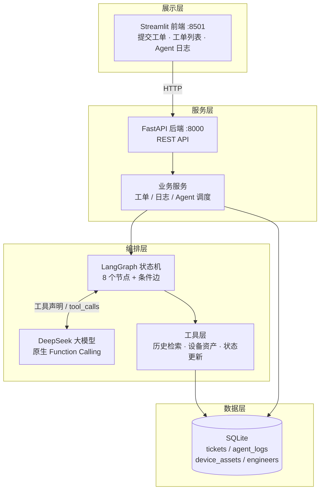
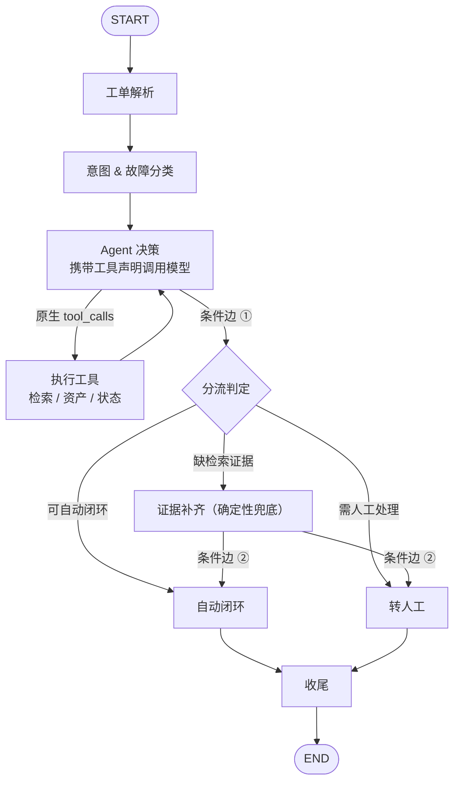
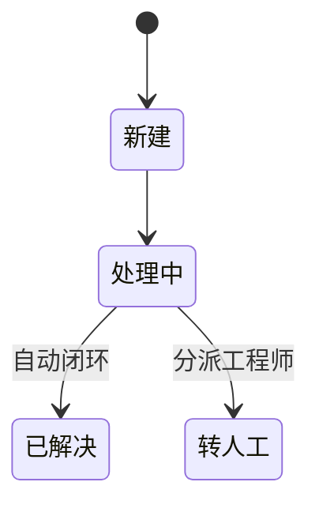

# IT 运维智能工单自动处理 Agent

> 让 IT 工单「自己走完流程」——用自然语言描述故障，系统自动完成解析、分类、检索、决策与闭环。

本项目的核心是 **业务流程编排（LangGraph 状态机）+ 大模型原生工具调用（Function Calling）+ 工单状态流转**，而非知识库问答。它用一条可解释、可观测、可离线运行的状态机，把「员工报障」到「问题闭环」的全过程自动化：能复用历史方案的自动解决，需要人处理的自动派单。

编排框架仅使用 **LangGraph**，未引入 CrewAI / Agno / AutoGen 等重型多 Agent 框架，整体轻量、易读、易扩展。

---

## 目录

1. [项目简介](#1-项目简介)
2. [核心价值与亮点](#2-核心价值与亮点)
3. [功能特性](#3-功能特性)
4. [系统架构](#4-系统架构)
5. [处理流程与状态机](#5-处理流程与状态机)
6. [核心功能说明](#6-核心功能说明)
7. [技术规格](#7-技术规格)
8. [快速开始](#8-快速开始)
9. [使用指南](#9-使用指南)
10. [配置项](#10-配置项)
11. [项目结构](#11-项目结构)
12. [测试与验收](#12-测试与验收)
13. [部署到 GitHub](#13-部署到-github)
14. [文档索引](#14-文档索引)

---

## 1. 项目简介

### 1.1 要解决的问题

传统 IT 工单处理高度依赖人工：员工用文字描述故障，运维人员再逐条判断、翻找历史处理记录、确认设备信息、决定能否自助解决。效率低、口径不一、经验难以沉淀。

### 1.2 我们提供什么

系统接收员工的自然语言工单，由大模型驱动、由状态机编排，自动完成一整条闭环：

```
工单解析 → 意图/故障分类 → 多工具调用（检索历史方案 + 查询设备资产 + 更新状态）
        → 分支决策 → 自动生成解决方案 或 自动派单通知 → 状态落库
```

### 1.3 适用对象

- **企业 IT 运维团队**：希望降低重复性工单的人力消耗，并沉淀可复用方案。
- **技术评审与学习者**：希望参考一条完整、可运行的「LangGraph 状态机 + 原生 Function Calling」工程实践。

---

## 2. 核心价值与亮点

| 价值 | 说明 |
|---|---|
| **真正的业务闭环，而非问答** | 输出的是工单状态变更与可执行的解决方案/派单通知，而不是一段聊天回复 |
| **决策可解释、结果可复现** | 分流规则由代码确定性裁决（P0 / 高危类型 / 分类结果 / 相似度阈值），模型不"拍脑袋"决定去向，每条决策都附带原因 |
| **原生工具调用** | 3 个业务工具由模型自主决策调用，而非硬编码 `if-else`，贴近真实 Agent 形态 |
| **开箱即用、离线可跑** | 无需 API Key 即可用离线模式完整演示全流程，降低体验与评审门槛 |
| **全链路可观测** | 每一步 Agent 思考与每次工具调用的入参出参都落库并可视化，便于审计与调优 |
| **轻量可控** | 仅用 LangGraph，无重型多 Agent 框架，依赖少、易读、易二次开发 |

---

## 3. 功能特性

| 能力 | 说明 |
|---|---|
| 工单解析 | 从自然语言结构化抽取：标题、故障类型、紧急等级、设备编号、联系方式 |
| 意图分类 | 区分「可自动解决」与「必须人工处理」 |
| 原生 Function Calling | 模型自主调用 3 个业务工具，支持多轮 ReAct 循环 |
| 条件边分支 | 2 处 LangGraph 条件边：工具循环路由 + 自动/人工分流 |
| 状态持久化 | 工单状态与 Agent 日志全部落 SQLite |
| 全链路日志 | 控制台 + 滚动文件 + 数据库三通道，每个节点与工具调用可追溯 |
| 离线可用 | 离线模式无需 API Key 即可完整演示 |
| 可视化前端 | Streamlit 三页签：提交工单 / 工单列表 / Agent 处理日志 |

---

## 4. 系统架构

系统自下而上分为展示层、服务层、编排层与数据层，各层职责清晰、通过标准接口解耦。



| 层 | 组件 | 职责 |
|---|---|---|
| 展示层 | Streamlit | 提交工单、查看列表与详情、可视化 Agent 处理日志 |
| 服务层 | FastAPI + 业务服务 | 提供 REST 接口，负责工单 CRUD、状态流转、日志落库与 Agent 调度 |
| 编排层 | LangGraph + DeepSeek + 工具层 | 状态机编排、模型推理、原生工具调用与分支决策 |
| 数据层 | SQLite | 持久化工单、Agent 日志、设备资产与工程师信息 |

---

## 5. 处理流程与状态机

### 5.1 编排流程

状态机共 8 个节点，通过 2 处条件边实现「工具循环」与「自动/人工分流」。



| 节点 | 职责 |
|---|---|
| `parse_ticket` | 大模型抽取工单字段并回写 |
| `classify` | 判定可自动解决 / 必须人工 |
| `agent` | 携带工具声明调用模型，解析原生 `tool_calls` |
| `execute_tools` | 执行工具，并将结果回灌为 `tool` 消息 |
| `gather_evidence` | 模型漏调检索工具时的确定性兜底 |
| `auto_resolve` | 生成解决步骤 → 状态「已解决」+ 标记自动闭环 |
| `escalate_human` | 按故障类型分派工程师 → 状态「转人工」+ 生成通知 |
| `finalize` | 收尾并汇总日志 |

### 5.2 工单状态流转



### 5.3 分流判定规则

命中以下**任一**条件即 **转人工**；否则 **自动闭环**。判定由代码确定性执行，并记录在 `decision_reason` 中。

| # | 条件 |
|---|---|
| 1 | 紧急等级为 `P0` |
| 2 | 故障类型属于高危：`服务器 / 数据库 / 网络核心 / 安全事件` |
| 3 | 模型分类判定 `auto_resolvable = false` |
| 4 | 历史方案最高匹配度 `< MATCH_THRESHOLD`（默认 `0.42`） |

---

## 6. 核心功能说明

### 6.1 工单解析

模型从自然语言中抽取结构化字段（标题、故障类型、紧急等级、设备编号、联系方式），并将故障类型约束到系统预设的 10 类枚举：
`打印机 / 账号权限 / 网络 / 硬件 / 软件 / 服务器 / 邮箱 / 数据库 / 安全事件 / 其他`。

### 6.2 意图与故障分类

判断工单是否具备自动解决条件，输出分类结论与理由，作为分流判定的输入之一。

### 6.3 工具调用（原生 Function Calling）

| 工具 | 作用 | 数据源 |
|---|---|---|
| `search_similar_tickets` | 按故障类型与描述检索历史已解决工单，返回最相似方案与匹配度 | `tickets` 中 `status='已解决'` 的记录 |
| `get_device_asset` | 按设备编号查询型号、系统、IP、位置、责任人、保修与健康状态 | `device_assets` |
| `update_ticket_status` | 更新工单状态（新建/处理中/已解决/转人工）并追加备注 | `tickets` + `agent_logs` |

工具声明集中定义于 [registry.py](app/tools/registry.py)，实现位于 `app/tools/`。

### 6.4 分支决策与结果产出

- **自动闭环**：匹配到成熟方案 → 自动生成解决步骤并回复，工单标记为「已解决」。
- **转人工**：无匹配方案或高危/P0 → 自动分派对应工程师，生成通知消息，工单标记为「转人工」。

### 6.5 状态持久化与日志

- 工单状态与结果持久化到 SQLite，前端与接口均可查询。
- 每个节点与每次工具调用的入参出参均落库，可在前端「Agent 处理日志」页签逐条查看。

---

## 7. 技术规格

| 维度 | 选型 |
|---|---|
| 语言 | Python 3.13 |
| 后端框架 | FastAPI（Uvicorn 提供服务） |
| Agent 编排 | LangGraph（`StateGraph` + 条件边 + ReAct 循环） |
| 大模型 | DeepSeek（OpenAI 兼容接口，原生 Function Calling） |
| 数据访问 | SQLAlchemy 2.x |
| 数据校验 | Pydantic v2 / pydantic-settings |
| 数据库 | SQLite |
| 前端 | Streamlit |
| 日志 | 标准 logging：控制台 + 滚动文件 + 数据库 |

**数据模型（4 张表）**

| 表 | 说明 |
|---|---|
| `tickets` | 工单主表：描述、类型、等级、设备、状态、处理模式、解决方案、派单人、决策原因等 |
| `agent_logs` | Agent 处理日志：所属工单、节点、级别、摘要、JSON 细节 |
| `device_assets` | 设备资产：编号、主机名、类型、系统、IP、位置、责任人、保修、健康状态 |
| `engineers` | 工程师：专长、级别、联系方式、在手工单数、平均处理时长 |

---

## 8. 快速开始

### 8.1 环境要求

| 项 | 要求 |
|---|---|
| 操作系统 | Windows 10/11（提供 PowerShell 脚本） |
| Python | 3.13（`py` 启动器可用） |
| 端口 | `8000`（后端）、`8501`（前端）空闲 |
| DeepSeek API Key | 可选；未配置时自动使用离线模式 |
| 网络 | 首次安装依赖需可访问 PyPI（或国内镜像） |

### 8.2 一键启动（推荐）

```powershell
.\run.ps1
```

脚本会幂等地自动完成：创建虚拟环境 → 安装依赖 → 生成 `.env` → 初始化数据库 → 启动后端（8000）→ 启动前端（8501）→ 打开浏览器。按 `Ctrl+C` 停止前端时，脚本会同时关闭后端。

### 8.3 手动安装（可选）

```powershell
py -m venv .venv
.\.venv\Scripts\python.exe -m pip install -r requirements.txt
Copy-Item .env.example .env
.\.venv\Scripts\python.exe scripts\init_db.py
.\.venv\Scripts\python.exe -m uvicorn app.main:app --host 127.0.0.1 --port 8000
.\.venv\Scripts\python.exe -m streamlit run frontend\streamlit_app.py --server.port 8501
```

### 8.4 单独启动服务

```powershell
.\run_backend.ps1     # 仅后端：http://127.0.0.1:8000/docs
.\run_frontend.ps1    # 仅前端：http://127.0.0.1:8501
```

### 8.5 访问地址

| 服务 | 地址 |
|---|---|
| 前端页面 | http://127.0.0.1:8501 |
| 接口文档（Swagger） | http://127.0.0.1:8000/docs |
| 健康检查 | http://127.0.0.1:8000/api/health |

### 8.6 启用真实大模型（可选）

编辑 `.env` 填入 `DEEPSEEK_API_KEY` 即可（`LLM_MODE=auto` 会在检测到 Key 时使用真实模型，否则回退离线模式）。

---

## 9. 使用指南

### 9.1 前端操作

| 页签 | 功能 |
|---|---|
| 📝 提交工单 | 输入自然语言故障描述（可选填联系方式、设备编号），提交后展示结果卡片：工单号、状态、类型、等级、处理模式、匹配度、决策原因、解决方案或派单通知 |
| 📋 工单列表 | 按状态筛选（全部 / 新建 / 处理中 / 已解决 / 转人工），查看列表与单条详情 |
| 🧠 Agent 处理日志 | 按工单查看时间线日志，展示每个节点与每次工具调用，可展开查看 JSON 细节 |

### 9.2 REST 接口

统一响应体：`{"code": 0, "message": "ok", "data": ...}`

| 方法 | 路径 | 说明 |
|---|---|---|
| POST | `/api/tickets` | 提交工单，同步跑完 Agent 并返回终态 |
| GET | `/api/tickets?status=&limit=` | 工单列表（可按状态过滤） |
| GET | `/api/tickets/{id}` | 工单详情 |
| GET | `/api/tickets/{id}/logs` | 该工单的 Agent 处理日志 |
| POST | `/api/tickets/{id}/rerun` | 重新触发 Agent |
| GET | `/api/devices` | 设备资产列表 |
| GET | `/api/health` | 健康检查（LLM 模式 / 数据库连通性） |

### 9.3 调用示例

```powershell
curl -X POST http://127.0.0.1:8000/api/tickets `
  -H "Content-Type: application/json" `
  -d '{\"description\": \"我的打印机 PC-1024 打印一直提示脱机，重启打印服务也不行\", \"user_contact\": \"张小明\"}'
```

---

## 10. 配置项（`.env`）

| 变量 | 默认值 | 说明 |
|---|---|---|
| `DEEPSEEK_API_KEY` | 空 | DeepSeek API Key（离线模式下可留空） |
| `DEEPSEEK_BASE_URL` | `https://api.deepseek.com` | OpenAI 兼容接口地址 |
| `DEEPSEEK_MODEL` | `deepseek-chat` | 模型名称 |
| `LLM_MODE` | `auto` | `auto`（有 Key 用真实，否则离线）/ `real` / `mock` |
| `LLM_TIMEOUT` | `60` | 单次模型调用超时（秒） |
| `DATABASE_URL` | `sqlite:///./data/itops.db` | 数据库连接串 |
| `MATCH_THRESHOLD` | `0.42` | 历史方案相似度阈值，低于该值转人工 |
| `MAX_ITERATIONS` | `6` | 单工单最大工具循环轮数 |
| `LOG_LEVEL` | `INFO` | 日志级别 |
| `BACKEND_URL` | `http://127.0.0.1:8000` | 前端访问的后端地址 |

> `.env` 含敏感信息，已在 `.gitignore` 中排除，请勿提交到版本库。

---

## 11. 项目结构

```
demo/
├── README.md                   # 项目说明（本文档）
├── 使用说明.md                 # 使用者手册（功能 / 操作 / 配置 / 故障排查）
├── spec.md / tasks.md / checklist.md   # 设计规格 / 任务拆解 / 验收清单
├── requirements.txt
├── .env.example                # 环境变量模板
├── run.ps1                     # 一键启动（后端 + 前端）
├── run_backend.ps1 / run_frontend.ps1  # 单独启动
├── app/
│   ├── config.py               # 配置（pydantic-settings）
│   ├── constants.py            # 状态 / 故障类型 / 高危类型等常量
│   ├── logging_config.py       # 日志系统（控制台 + 滚动文件）
│   ├── main.py                 # FastAPI 入口
│   ├── db/                     # engine / 模型 / 种子数据
│   ├── schemas/                # 请求与响应模型
│   ├── llm/                    # 大模型客户端（真实 / 离线双模式）
│   ├── tools/                  # 供模型调用的 3 个工具
│   ├── agent/                  # LangGraph 状态机（state / nodes / routing / graph）
│   ├── services/               # 工单服务 / 日志服务 / Agent 调度
│   └── api/routes.py           # REST 接口
├── frontend/streamlit_app.py   # Streamlit 三页签页面
├── scripts/                    # 初始化数据库 / 测试与验收脚本
├── data/                       # SQLite 数据库文件
└── logs/                       # 运行日志
```

---

## 12. 测试与验收

```powershell
# 5 条样例端到端验收（进程内执行，无需启动服务）
.\.venv\Scripts\python.exe scripts\demo_test.py

# 通过已启动的后端提交
.\.venv\Scripts\python.exe scripts\demo_test.py --http

# 工具层自测
.\.venv\Scripts\python.exe scripts\test_tools.py

# 单条工单逐节点追踪状态机
.\.venv\Scripts\python.exe scripts\test_graph.py
.\.venv\Scripts\python.exe scripts\test_graph.py "核心数据库服务器宕机了，业务全部中断"
```

| # | 输入描述 | 期望结果 |
|---|---|---|
| 1 | 我的打印机 PC-1024 打印一直提示脱机，重启打印服务也不行 | 已解决 / 自动闭环 |
| 2 | 核心数据库服务器宕机了，业务全部中断，十万火急！ | 转人工（P0 + 高危类型） |
| 3 | 公司新采购的示波器驱动装不上，型号 XYZ-9 | 转人工（无匹配方案） |
| 4 | 我忘记 VPN 密码了，需要重置 | 已解决 / 自动闭环 |
| 5 | 会议室投影仪没信号，设备编号 PJ-03 | 转人工（匹配度不足） |

> 验收明细与实测结果见 [checklist.md](checklist.md) 与 [spec.md](spec.md)。

---

## 13. 部署到 GitHub

```powershell
# 1) 初始化本地仓库
git init
git branch -M main

# 2) 提交前安全检查：确认 .env 等敏感文件已被忽略
git status --short
git check-ignore -v .env data/itops.db logs/app.log

# 3) 提交
git add .
git commit -m "feat: IT 运维智能工单自动处理 Agent 初始版本"

# 4) 在 https://github.com/new 创建空仓库（不要勾选 README/.gitignore/license）

# 5) 关联远程并推送
git remote add origin https://github.com/<用户名>/<仓库名>.git
git push -u origin main
```

> **安全须知**：`.env`、`.venv/`、`data/itops.db`、`logs/` 已在 `.gitignore` 中排除，请勿提交敏感信息；GitHub 推送需使用 Personal Access Token 或 SSH 密钥。

---

## 14. 文档索引

| 文档 | 面向 | 内容 |
|---|---|---|
| [README.md](README.md) | 外部读者 / 开发者 | 项目介绍、架构、功能、规格、快速开始（本文档） |
| [使用说明.md](使用说明.md) | 使用者 / 运维 | 前置条件、安装、配置、操作指南、故障排查、维护 |
| [spec.md](spec.md) | 设计与评审 | 架构设计、数据模型、状态机、接口设计、验收结果 |
| [checklist.md](checklist.md) | 验收 | 逐项验收清单与实测记录 |